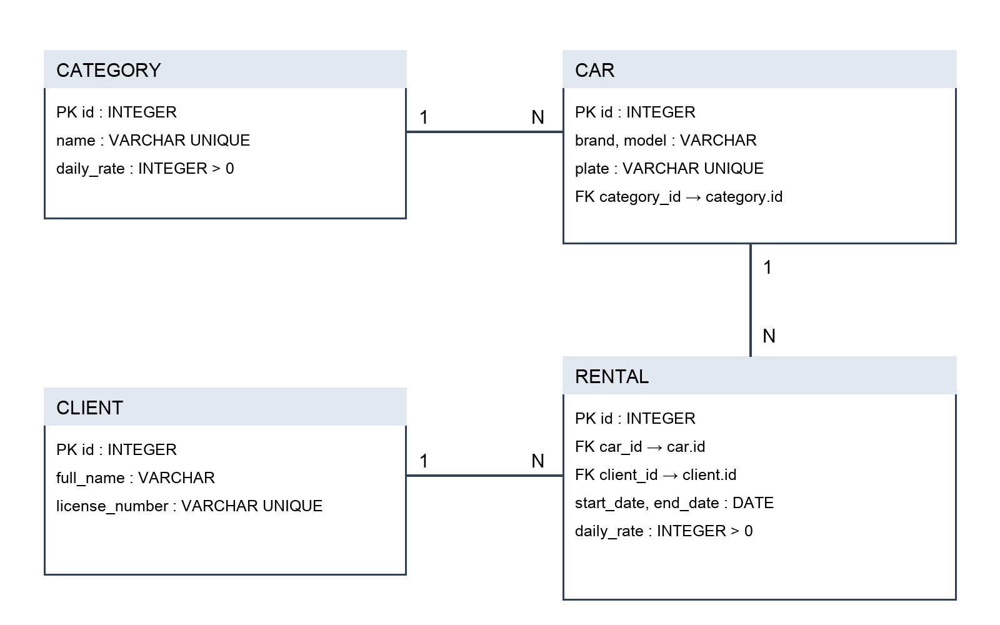

# AutoRent
АРМ компании по аренде автомобилей — лабораторные работы 1 и 2.

Репозиторий: https://github.com/jnlleux/applied-is-project-2026

## Схема базы данных


Исходник схемы: [er-diagram.drawio](docs/er-diagram.drawio).
Category → Car, Car → Rental и Client → Rental — связи один-ко-многим.
Клиенты и автомобили связаны многие-ко-многим через Rental: у связи есть
даты и собственный тариф. В учебное ядро входят четыре сущности;
платежи, штрафы и сотрудники остаются за рамками этих двух работ.

## Запуск на macOS
Требуется Python 3.10 или новее; проект проверен с Python 3.12.
```bash
python3 -m venv .venv
source .venv/bin/activate
python -m pip install -r requirements-lock.txt
python seed.py
python inspect_db.py
python verify.py
```
`requirements.txt` содержит четыре требуемые библиотеки. `requirements-lock.txt`
фиксирует версии проверенного окружения для повторяемой установки.

Экран реальной базы:
```bash
python -m streamlit run frontend/app.py --browser.gatherUsageStats false
```
Открыть http://localhost:8501. Вкладки показывают четыре таблицы, связанные
записи и ER-диаграмму. Это учебный просмотр данных, без редактирования.

В отдельном терминале:
```bash
python -m uvicorn app.main:app --reload
```
Проверка FastAPI: http://127.0.0.1:8000/ — ответ status: ok.
Документация: http://127.0.0.1:8000/docs.

## Демонстрация преподавателю
1. Открыть эту папку в VS Code. Интерпретатор — `.venv/bin/python`.
2. Показать `docs/er-diagram.png`: четыре сущности, ключи и связи 1:N.
3. Показать `app/database/models.py`: Field, foreign_key и Relationship.
4. Выполнить `python seed.py`, затем `python inspect_db.py`: по три записи
   в каждой таблице, внешние ключи включены, связанные данные читаются.
5. Выполнить `python verify.py`: PASS подтверждает ограничения, связи,
   расчёт стоимости и отсутствие дублей при повторном seed. Этот тест
   использует отдельную временную БД и не меняет действующую database.db.
6. Открыть экран Streamlit, вкладку «Связи таблиц».
7. В Source Control показать историю коммитов; в терминале — команды ниже.
8. Открыть GitHub и сравнить последний коммит с локальным.

```bash
git remote -v
git status -sb
git log --oneline -3
git check-ignore .venv/bin/python database.db
```
В меню Terminal → Run Task доступны пять готовых команд для шагов демонстрации.
Если сервер уже запущен, используйте открытый адрес или сначала остановите
его сочетанием Ctrl+C; два сервера не должны занимать один порт.

## Назначение файлов
- `app/database/models.py` — ORM-модели, первичные и внешние ключи, связи.
- `app/database/db.py` — движок SQLite, PRAGMA foreign_keys и создание таблиц.
- `seed.py` — создание схемы и трёх записей на таблицу одной транзакцией.
- `inspect_db.py` — чтение текущей базы и показ связей.
- `verify.py` — независимая проверка на временной базе.
- `app/main.py` — минимальный FastAPI сервер.
- `app/api/` — место для маршрутов следующей лабораторной.
- `frontend/app.py` — экран просмотра данных Streamlit.
- `.gitignore` — исключает окружение, локальную БД, кеши и .env.

## Правила данных
Стоимость равна количеству суток × тарифу. Деньги — целые тенге.
Тариф копируется в аренду, чтобы изменение категории не меняло историю.
Окончание позже начала; тариф положительный. Номера автомобилей,
водительских удостоверений и названия категорий уникальны.
Все клиенты и номера в seed — вымышленные учебные значения.
Повторный seed не изменяет непустую базу. Для отдельной новой базы можно
задать DATABASE_URL; действующую базу удалять для демонстрации не нужно.
Проверки пересечения аренд, роли и полноценный CRUD относятся к следующим этапам.
`create_all` создаёт отсутствующие таблицы, но не выполняет миграции существующих.

## Краткие ответы для защиты
- venv изолирует зависимости проекта от других Python-программ.
- commit сохраняет изменения локально; push отправляет коммиты на GitHub.
- .gitignore не позволяет добавлять локальную БД, окружение и секреты в Git.
- Ветки изолируют изменения; в командной работе main защищают проверками и review.
- ORM связывает Python-объекты с таблицами реляционной БД.
- car_id — SQL-столбец внешнего ключа; car — Python-связь Relationship, не столбец.
- Seed даёт воспроизводимые данные для проверки запросов и связей.
- echo=True выводит выполняемые SQL-команды для отладки.
- Код ИИ нужно проверять: типы, связи, ограничения и запуск, а не только синтаксис.

## Документация
- https://sqlmodel.tiangolo.com/tutorial/relationship-attributes/define-relationships-attributes/
- https://docs.sqlalchemy.org/en/20/dialects/sqlite.html#foreign-key-support
