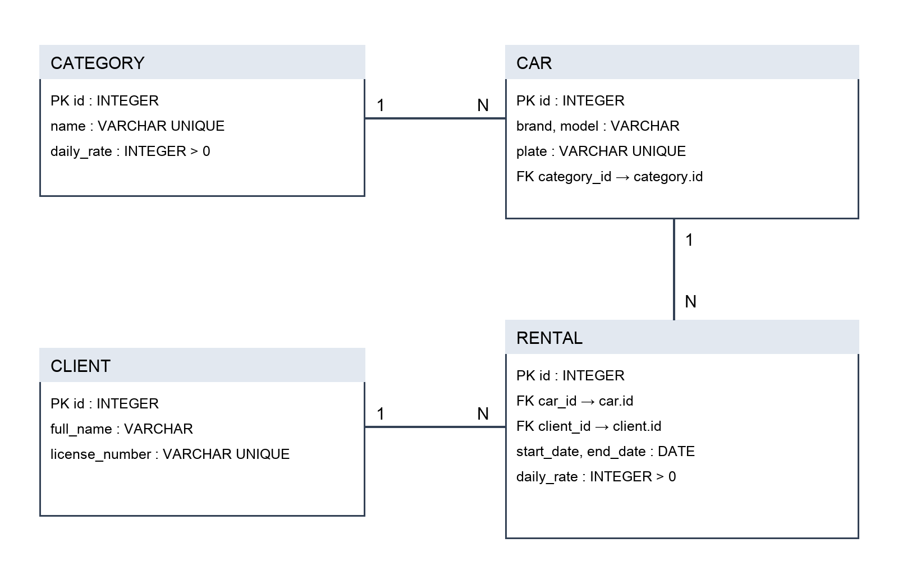

# Информационная система AutoRent

**Курс:** Прикладное программное обеспечение информационных систем, 2026.
**Автор и группа:** заполнить перед сдачей.

## 1. Описание предметной области
AutoRent автоматизирует работу менеджера проката автомобилей. Менеджер ведёт
категории и тарифы, автопарк, клиентов и договоры аренды. Доступны поиск,
фильтрация по тарифу, создание, изменение и удаление записей. Система проверяет
даты аренды, внешние ключи, уникальность номеров и пересечение бронирований.
Учебная система предназначена для локальной демонстрации; авторизация не реализована.

## 2. Архитектура данных


Category → Car, Car → Rental, Client → Rental — связи один-ко-многим.
Rental связывает клиентов и автомобили и хранит даты и исторический тариф.
Стоимость: количество суток × тариф в целых тенге. Интервал аренды включает
начало и не включает конец: возврат и следующая выдача в один день допустимы.
Удаление связанных справочных записей возвращает 409.

## 3. Технологический стек
Python 3.12+, FastAPI, Uvicorn, SQLModel, SQLite, Streamlit, Requests,
pytest, HTTPX, Docker Compose. ИИ-помощник Codex использовался при реализации
и проверке кода. Проверенные версии находятся в requirements-lock.txt.

## 4. Запуск
Установите Docker Desktop и запустите его службу.
```bash
git clone https://github.com/jnlleux/applied-is-project-2026.git
cd applied-is-project-2026
docker compose up --build
```
Интерфейс: http://localhost:8501. Swagger: http://localhost:8000/docs.
При пустой базе автоматически создаются учебные данные; непустая база сохраняется.
SQLite хранится в named volume rental_data. `docker compose down` сохраняет данные;
`docker compose down -v` удаляет том и данные, для обычной остановки его не используйте.
Frontend обращается к backend по имени сервиса http://backend:8000.
Порты опубликованы только на 127.0.0.1.

Альтернатива без Docker, из корня проекта:
```bash
python3 -m venv .venv
source .venv/bin/activate
python -m pip install -r requirements-lock.txt
python seed.py
python -m uvicorn app.main:app --reload
```
В другом терминале активируйте то же окружение:
```bash
python -m streamlit run app/frontend/ui.py
```
DATABASE_URL задаёт путь к SQLite, BACKEND_URL — адрес API для интерфейса.
SQL_ECHO=1 включает журнал SQL. Старый `frontend/app.py` запускает новый интерфейс.

## 5. Проверки
```bash
python -m pytest -q
python verify.py
docker compose config
```
API-тесты используют отдельные временные базы. Проверяются CRUD, поиск,
диапазоны цен, 404, 422, 409, связи и пересечения аренды. Старый verify.py
проверяет модели и повторный seed. Проверка Docker-конфигурации сама по себе
не подтверждает успешную сборку контейнеров.

## 6. Лабораторные работы
| Работа | Результат | Файлы |
|---|---|---|
| 1–2 | Исходная схема, ORM, seed | app/database, seed.py, docs/er-diagram.png |
| 3 | GET, POST, Depends, Swagger, 201/422 | app/main.py, app/routers/items.py, app/schemas.py |
| 4 | PATCH, DELETE, поиск, тарифы, 404/409 | app/routers/items.py |
| 5 | HTTP интерфейс, таблицы и формы | app/frontend/ui.py |
| 6 | Два контейнера, сеть, том, healthcheck | Dockerfile, Dockerfile.frontend, docker-compose.yml |
| 7 | Изолированные API-тесты, документация | tests/test_api.py, docs/DEFENSE_RU.txt |

Маршруты /categories, /cars, /clients, /rentals поддерживают GET и POST,
а /{resource}/{id} — GET, PATCH и DELETE. Поиск: search; тариф: min_price,
max_price (для машин — тариф категории). Пример: /cars?search=Toyota&min_price=10000.
PATCH изменяет только переданные поля; явный null для обязательного поля запрещён.
SQLite BEGIN IMMEDIATE сериализует создание/изменение аренды до проверки пересечений.

## 7. Документация библиотек
- https://fastapi.tiangolo.com/tutorial/testing/
- https://sqlmodel.tiangolo.com/tutorial/fastapi/update/

Порядок демонстрации и ответы: docs/DEFENSE_RU.txt.
История разработки сохранена честно: новые коммиты не имитируют работу за семь недель.
