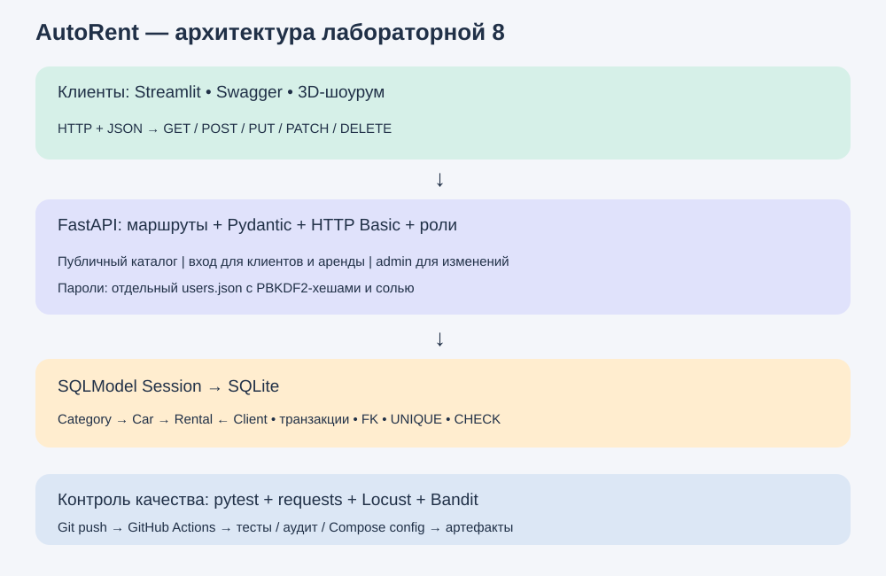
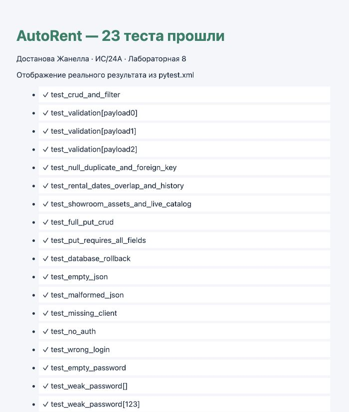
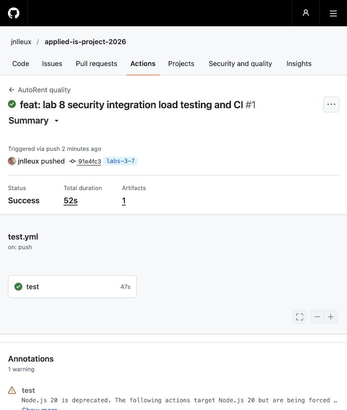
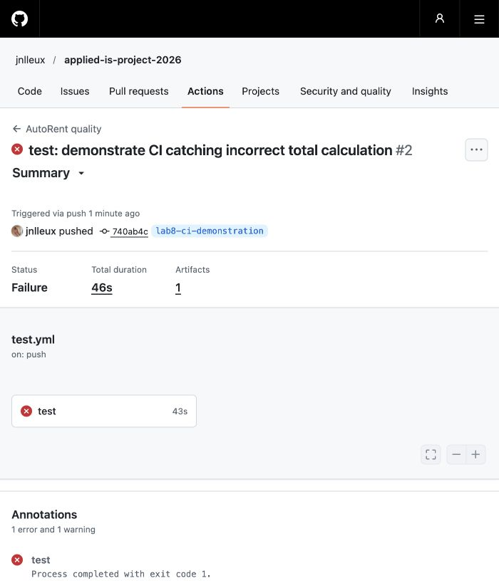
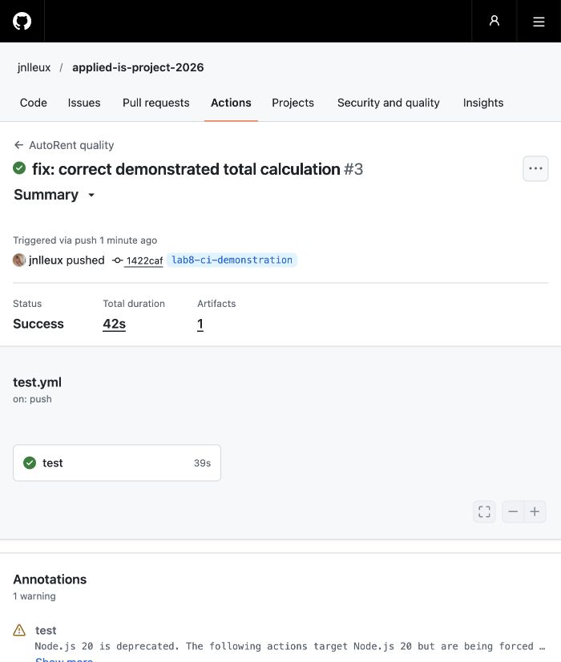
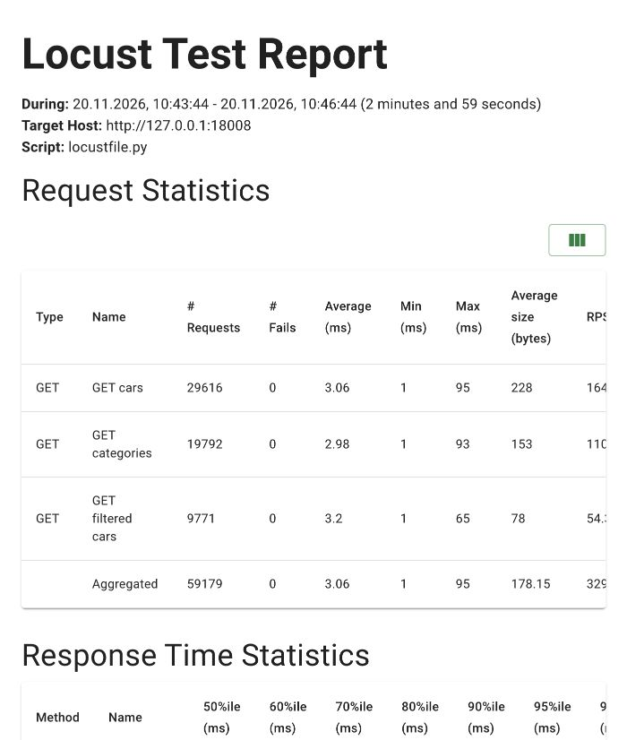

# Лабораторная работа №8

**Тема:** Комплексное интеграционное, нагрузочное и безопасностное тестирование AutoRent. Автоматизация контроля качества.

**Автор:** Достанова Жанелла. **Группа:** ИС/24А. **Дата:** 20 ноября 2026.

## 1. Цель

Проверить взаимодействие интерфейса, REST API и базы данных, выявить недостатки безопасности, измерить поведение при нагрузке и автоматизировать проверки в GitHub Actions. Практическая область — прокат автомобилей; основное внимание уделено целостности аренды, ролям и API.

## 2. Архитектура



Streamlit вызывает API через requests; Swagger служит интерактивным клиентом; 3D-шоурум читает публичный каталог. FastAPI проверяет вход через Pydantic и доступ через HTTP Basic. SQLModel открывает сессию SQLite для каждого запроса. Пароли находятся вне репозитория в отдельном users.json в виде PBKDF2-хешей с индивидуальной солью.

| Компонент | Возможная ошибка 1 | Возможная ошибка 2 | Интеграционная проверка |
|---|---|---|---|
| Streamlit / 3D | Сервер недоступен | Неверный адрес backend | UI → HTTP; каталог без авторизации |
| FastAPI | Некорректный JSON | Несуществующий ID | HTTP 400/404 и отсутствие изменений |
| SQLite / SQLModel | Нарушение FK | Ошибка обязательного поля | Откат транзакции, CRUD, ограничения |
| Аутентификация | Пустой пароль | Неверный логин | 401, одинаковое безопасное сообщение |
| Роли | Читатель вызывает POST | Гость читает клиентов | 403 и 401 соответственно |
| Валидация / ошибки | Отрицательный тариф | Утечка введённого секрета | 422 без input в теле ошибки |
| CI | Дефект бизнес-логики | Ошибка зависимостей | Реальный запуск после push |

## 3. Средства и воспроизводимость

Python 3.12, FastAPI, SQLModel, SQLite, pytest, HTTPX, requests, Locust, psutil, Bandit, GitHub Actions. Использованы исходные модели лабораторных 1–7 и имеющийся 3D-шоурум. Docker Desktop по-прежнему не подтвердил запуск, поэтому нагрузка измерена на локальном uvicorn, а не в контейнерах.

```bash
python -m pip install -r requirements-dev.txt
python -m pytest -v --junitxml=reports/lab8/pytest.xml
python -m bandit -r app -f json -o reports/lab8/bandit.json
python -m scripts.http_check
python scripts/run_load.py
```

Последние две команды сами создают временную БД и завершают свой сервер. Порты 18009 и 18008 должны быть свободны. Главная база не используется. В тестовых сценариях нет реальных клиентских данных.

## 4. API и интеграционные результаты

Через настоящий requests и отдельный uvicorn выполнено **12 HTTP-проверок, все прошли**. Полные фактические статусы и тела ответов: [http-results.json](../../reports/lab8/http-results.json).

| Операция | Фактический результат |
|---|---|
| GET /categories | 200, массив |
| POST корректной категории | 201, новая запись с ID |
| PUT полной категории | 200, заменённые значения |
| GET созданного ID | 200, сохранённые данные |
| POST пустого объекта | 422, обязательные поля отсутствуют |
| POST синтаксически неверного JSON | 400 |
| GET отсутствующего клиента после входа | 404 |
| GET клиентов без входа | 401 |
| Вход с неизвестным логином | 401 |
| DELETE читателем | 403 |
| DELETE администратором | 204 |
| GET после удаления | 404 |

400 означает неправильный синтаксис JSON. 422 оставлен для корректного JSON с неверными значениями — это стандартный подход FastAPI. Поэтому пустой объект возвращает 422, а не искусственно приведённый к 400 результат.

## 5. База и транзакции

test_database_rollback вставляет в одну транзакцию корректную категорию и категорию с daily_rate=None. NOT NULL вызывает IntegrityError, выполняется rollback. Список записей после отката равен списку до транзакции: первая вставка также отменена. Затем успешная вставка доказывает, что сессия снова пригодна к работе.

Другие проверки подтверждают уникальность названия, существование внешних ключей, запрет удаления используемой категории и сохранение тарифа аренды после изменения категории. Пересекающаяся аренда одной машины отклоняется, смежные интервалы допустимы.

## 6. Нагрузка

Сценарий Locust: GET /cars (вес 3), GET /categories (вес 2), GET фильтрованных машин (вес 1), пауза пользователя 0,1–0,5 секунды. Четыре прогона: 5 пользователей / 60 секунд; 20 / 120; 50 / 180; 100 / 180. Все пользователи запускаются примерно за секунду; время включает разгон.

CPU измеряется для процесса backend, 100% означает одно полностью занятое логическое ядро. RAM — RSS этого процесса. Генератор нагрузки работает на том же компьютере и конкурирует за ресурсы. Тест характеризует чтение небольшого учебного каталога, не доказывает пропускную способность записи, входа с PBKDF2 или большого объёма данных.

Результаты и сравнение 50/100 пользователей: [таблица и графики](LOAD_8.md). Исходные CSV, HTML-отчёты Locust и замеры ресурсов находятся в reports/lab8.

## 7. Безопасность и исправления

| Сценарий | Результат |
|---|---|
| Пустой/короткий/без букв/без цифр пароль при создании | ValueError, учётная запись не создана |
| Пустой пароль при входе | 401 |
| Несуществующий логин | 401 |
| Гость обращается к клиентам или изменяет данные | 401 |
| Читатель выполняет административный POST/DELETE | 403 |
| Некорректный JSON | 400 |
| Неверные значения полей | 422 |
| Пароль в сообщениях ошибок и захваченных application-логах | Не обнаружен тестом |
| SQL-подобная строка поиска | Не расширяет выборку |

**Обнаружено и исправлено:** ранее изменения данных не требовали входа; добавлены require_user/require_admin. Ранее ValidationError мог включать исходный ввод; теперь выдаются только описание и расположение ошибки. Для malformed JSON добавлен 400. Реализован PUT с полной схемой, требуемый в задании.

Bandit проверил app и не сообщил находок: [JSON-аудит](../../reports/lab8/bandit.json). Это статический анализ, а не доказательство отсутствия всех уязвимостей. Проверка логов покрывает записи приложения, но не внешние прокси. Ограничения: HTTP Basic требует HTTPS вне localhost, нет MFA и ограничения попыток входа, файл пользователей управляется локальным администратором. До публичного размещения нужны HTTPS, ограничение запросов, управление сессиями и защищённое хранение конфигурации.

## 8. Автоматические тесты

**23 тестовых случая прошли**, из них 7 унаследованы из прежней версии и 16 добавлены для лабораторной 8. Тесты включают API–БД, полный PUT/CRUD, rollback, доступ по ролям, обработку JSON и отсутствие секретов в ошибках. [JUnit XML](../../reports/lab8/pytest.xml) сохраняет результат.

Unit-тесты политики пароля проверяют отдельную функцию. Интеграционные тесты связывают маршруты, схемы, авторизацию и реальную временную SQLite. Помимо TestClient отдельно выполнены запросы requests к запущенному серверу.



## 9. GitHub Actions

Workflow .github/workflows/test.yml запускается при push и pull_request: установка зависимостей → pytest → Bandit → docker compose config → сохранение артефактов. Это CI контроля качества; автоматическое развёртывание публичного приложения не настроено и в задании не требуется.

Первый успешный запуск: [Actions 44681675368](https://github.com/jnlleux/applied-is-project-2026/actions/runs/44681675368).



Учебная ветка lab8-ci-demonstration содержит намеренный дефект: 100 + 2 вместо 100 * 2. Ожидалось 200, получалось 102. [Красный запуск](https://github.com/jnlleux/applied-is-project-2026/actions/runs/44681866937) подтвердил обнаружение ошибки. Исправление находится в следующем коммите 1422caf; рабочая ветка labs-3-7 не содержала намеренного дефекта.



## 10. Ответы на контрольные вопросы

1. Интеграционные тесты проверяют правильность взаимодействия нескольких компонентов.
2. Unit изолирует функцию или модуль; integration проверяет связи, например API и SQLite.
3. 200 — успех, 201 — создание, 204 — успех без тела, 400 — неверный синтаксис, 401 — нет действительного входа, 403 — недостаточно прав, 404 — отсутствует, 409 — конфликт, 422 — ошибка значений.
4. Нагрузочное тестирование бывает обычным, стрессовым, пиковым и длительным (soak).
5. Response Time — задержка ответа; Throughput — число завершённых запросов в секунду.
6. Транзакции, ограничения и rollback обеспечивают атомарность и целостность; проверка должна подтвердить отсутствие частичного сохранения.
7. Security testing ищет обход доступа, ошибки валидации, утечки и нарушения ролей.
8. pytest запускает тесты, предоставляет fixtures, параметризацию и понятные отчёты.
9. CI автоматически обнаруживает регрессии после изменения кода, сохраняя воспроизводимый результат.
10. Автотесты покрывают только написанные сценарии и тестовую среду; они не заменяют ручную проверку и аудит.
11. При росте нагрузки: измерить узкое место, добавить индексы и пагинацию, рассмотреть PostgreSQL и кеш чтения; масштабировать сервер после проверки БД.
12. Документация связывает версию кода, условия эксперимента и выводы, позволяя воспроизвести результат.

## 11. Вывод

AutoRent получил реальное разграничение доступа, полное обновление PUT, безопасные ответы об ошибках и воспроизводимый набор проверок. Требования по числу автоматических и интеграционных проверок выполнены. В отчёте приведены исходные результаты, ограничения эксперимента и отдельная история обнаружения и исправления ошибки в CI.

Исправление подтверждено успешным [запуском 44682094791](https://github.com/jnlleux/applied-is-project-2026/actions/runs/44682094791).



## Документация инструментов

- [Locust: headless, время и коды завершения](https://docs.locust.io/en/stable/running-without-web-ui.html)
- [FastAPI: HTTP Basic и безопасное сравнение](https://fastapi.tiangolo.com/advanced/security/http-basic-auth/)

## Реальная ошибка под нагрузкой

Первый прогон на 100 пользователях: 40 ответов HTTP 500 из 49 499 запросов. В server.log обнаружен SQLAlchemy TimeoutError: QueuePool size 5 + overflow 10, ожидание 30 секунд. Средняя задержка выросла до 63,23 мс, хотя p95 остался 5 мс: редкие долгие запросы находятся за пределами 95-го процентиля. CPU и RSS сами по себе не объясняют сбой — непосредственное ограничение зафиксировано в пуле соединений.

Для файловой SQLite выбран NullPool: соединение создаётся на сессию и закрывается при выходе, исключая ожидание свободного соединения в данном QueuePool. Это не делает SQLite многопользовательской серверной СУБД и не устраняет ограничения конкурентной записи. Сохранён повторный прогон на 100 пользователей, 180 секунд, в reports/lab8/after-fix.

[SQLAlchemy: отключение пула для файловой SQLite](https://docs.sqlalchemy.org/en/20/dialects/sqlite.html#disabling-connection-pooling-for-file-databases).

После исправления пула соединений полный CI с HTTP-проверками также прошёл: [запуск 44683013694](https://github.com/jnlleux/applied-is-project-2026/actions/runs/44683013694).

## Повторный прогон после исправления

100 пользователей, 180 секунд: **58975 запросов, 0 ошибок**, средний ответ **3.06 мс**, p95 **10 мс**, throughput **329.09 запросов/с**. Средний CPU backend — 36.7%, пиковый RSS — 95.0 МБ. Процесс Locust завершился с кодом 0.

До исправления: 40 ошибок и 63,23 мс среднего ответа. После NullPool: 0 ошибок и 3,06 мс. Это подтверждает устранение наблюдавшейся ошибки в данном сценарии чтения, но не гарантирует отсутствие проблем при записи или большей нагрузке.


