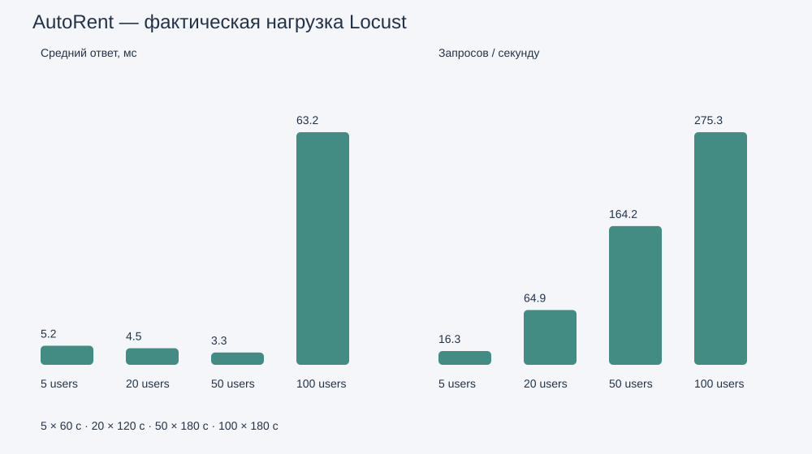
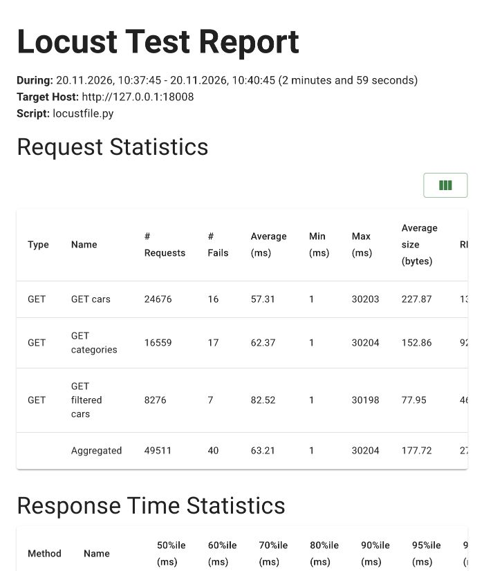
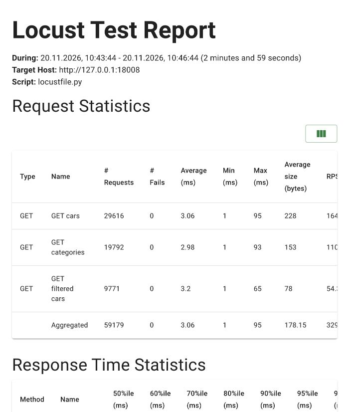

# Нагрузочное тестирование AutoRent

Фактические результаты Locust и psutil на локальном сервере; отдельная временная SQLite.

| Пользователи | Секунды | Запросы | Ошибки | Среднее, мс | p95, мс | Запросов/с | CPU среднее / пик, % | Пик RSS, МБ |
|---|---|---|---|---|---|---|---|---|
| 5 | 60 | 900 | 0 (0.00%) | 5.19 | 8.00 | 16.34 | 4.0 / 7.0 | 73.9 |
| 20 | 120 | 7744 | 0 (0.00%) | 4.51 | 8.00 | 64.89 | 15.3 / 19.2 | 72.5 |
| 50 | 180 | 29451 | 0 (0.00%) | 3.34 | 7.00 | 164.22 | 24.4 / 30.0 | 69.2 |
| 100 | 180 | 49499 | 40 (0.08%) | 63.23 | 5.00 | 275.33 | 25.9 / 34.8 | 77.4 |

При 50 → 100 пользователях средний ответ изменился с 3.34 до 63.23 мс; p95 — с 7.00 до 5.00 мс. Ошибок: 0 → 40. Средний CPU: 24.4% → 25.9%; пиковая память: 69.2 → 77.4 МБ.

Это измерения небольшого каталога на одном компьютере с генератором нагрузки. Они не позволяют доказать предельную ёмкость системы или назвать CPU/память узким местом только по процентам. Для роста данных сначала измерить запросы, добавить пагинацию и индексы; при интенсивной конкурентной записи перейти с SQLite на PostgreSQL. Кеширование каталога снизит число повторных чтений.



## Как читать данные

Таблица выше построена из последних CSV-снимков Locust. Итоговый HTML может содержать несколько дополнительных запросов, завершившихся между записью CSV и остановкой процесса; например, 49 499 в CSV и 49 511 в итоговом HTML при первом прогоне 100 пользователей. Это разные моменты фиксации одного запуска, а не разные эксперименты. Количество ошибок в обоих — 40.



При 100 пользователях p95 не показывает редкие таймауты: менее 5% запросов могли зависнуть на 30 секунд, заметно увеличив среднее. Поэтому одновременно анализируются среднее, p95, максимум, ошибки и журнал backend.

Повтор после исправления:

```bash
LOAD_RECHECK=1 LOAD_OUTPUT=reports/lab8/after-fix python scripts/run_load.py
```

## Повторный прогон после исправления

100 пользователей, 180 секунд: **58975 запросов, 0 ошибок**, средний ответ **3.06 мс**, p95 **10 мс**, throughput **329.09 запросов/с**. Средний CPU backend — 36.7%, пиковый RSS — 95.0 МБ. Процесс Locust завершился с кодом 0.

До исправления: 40 ошибок и 63,23 мс среднего ответа. После NullPool: 0 ошибок и 3,06 мс. Это подтверждает устранение наблюдавшейся ошибки в данном сценарии чтения, но не гарантирует отсутствие проблем при записи или большей нагрузке.



Для повторного прогона CSV зафиксировал 58 975 запросов, итоговый HTML — 59 179; оба показывают 0 ошибок. Разница связана с интервалом записи CSV перед завершением.
